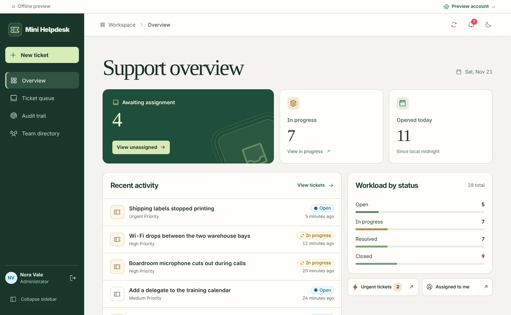
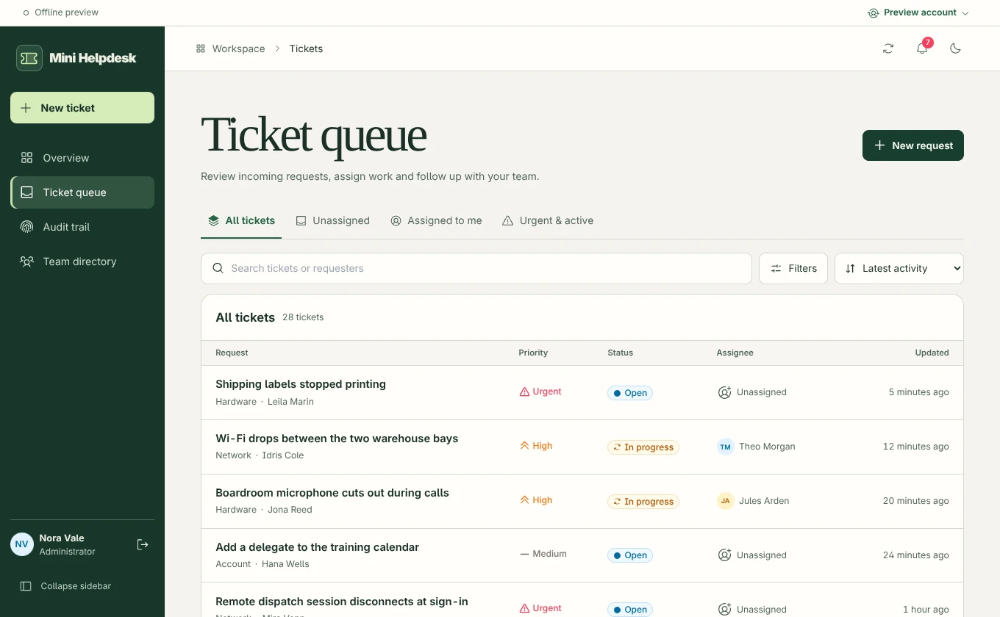
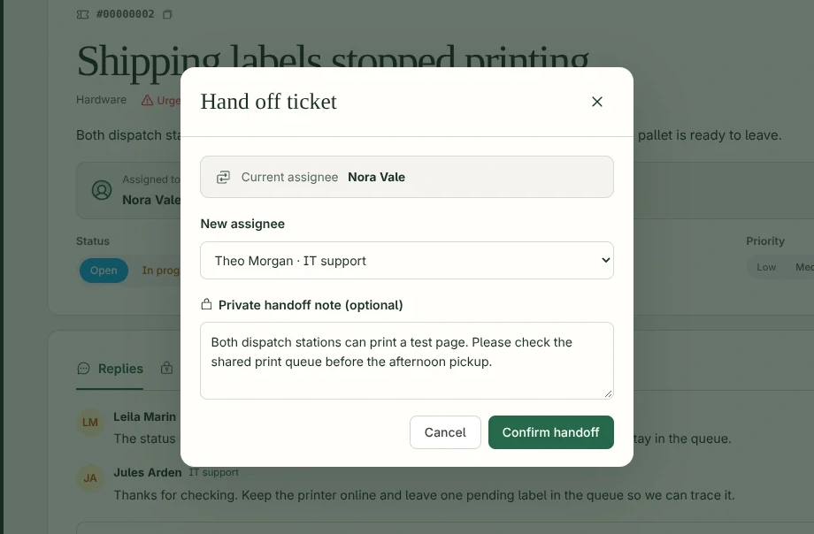
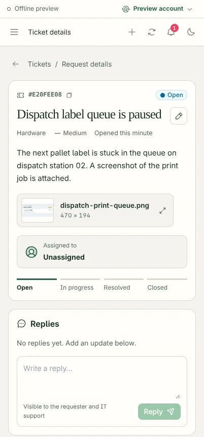
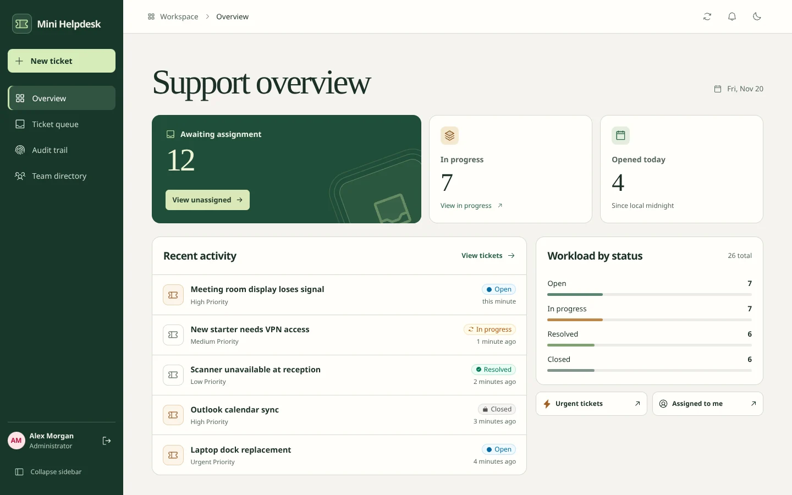

# Mini Helpdesk

A company support desk that takes a request from an employee’s first report through assignment, conversation and resolution. Employees follow their own tickets. The support team shares a queue, and administrators can review changes.

[Download the interactive HTML preview](https://github.com/Mubalshammari/mini-helpdesk/releases/download/preview-v1.0.0/Mini-Helpdesk-Preview.html) · [Download Windows setup (x64)](https://github.com/Mubalshammari/mini-helpdesk/releases/download/preview-v1.0.0/Mini-Helpdesk-Preview-Setup-x64.exe) · [Company workspace changes](https://github.com/Mubalshammari/mini-helpdesk/pull/1)



### Try the workspace

Open the downloaded HTML file in your browser. It starts with 28 fictional tickets. Use **Preview account** to switch roles. Your changes stay on the device and persist when you reopen the same copy in the same browser.

| Role | Something to try |
| --- | --- |
| Employee | Create a ticket, attach a screenshot, then open the ticket to view the image and conversation. |
| IT support | Open **Urgent tickets**, claim a request, then use **Hand off** to pass it to a colleague with a private note. |
| Administrator | Check the workload by status, then open **Audit trail** to see who changed a ticket or its assignment. |

### Inside the preview

| The support queue | A private handoff |
| --- | --- |
| [](docs/showcase/queue.webp) | [](docs/showcase/handoff.webp) |

<details>
<summary><strong>Employee view on a phone</strong> · a ticket with its screenshot attached</summary>



</details>

The screenshots above come from the offline preview. The connected application uses Supabase for employee accounts, shared tickets and database access rules.

## Connected application

I built Mini Helpdesk, an internal IT support ticketing system where employees
file and track tickets and IT staff triage, resolve, and review a tamper-proof
history of every change. The thing I cared about most: **every rule that matters
- who can see what, who can change what, how fast someone can spam the system -
is enforced by Postgres itself, not by the React app sitting in front of it.**

**Stack:** React (Vite) + Tailwind CSS + Supabase (Auth, Postgres, Row-Level
Security). One codebase ships two ways: a web app (→ Netlify) and a hardened
Windows desktop app (Electron → `.exe`), both talking to the same Supabase
project so their data is always in sync.

---

## Support workspace

The overview links directly to active urgent tickets, unassigned work and the signed-in agent’s queue. The ticket list supports priority, category and status filters. Sort by priority, oldest waiting or latest activity. The database returns 20 visible matches per page and counts the complete result set.

Staff claim tickets, read conversations and reply from the desktop queue. On phones, the same links open a full ticket. Public replies update the ticket’s activity time. The **Internal notes** tab gives IT and admins a separate handoff thread with its own database permissions. A private note does not notify the requester or change the public activity timestamp.

The company audit trail supports search, date ranges and pagination. Staff can inspect ticket events. Admins also see changes to access and account deletions. The team directory supports paginated name and role search. Demoting an agent returns their assignments to the queue.



[Desktop ticket queue](docs/preview/queue.webp) · [Employee ticket on mobile](docs/preview/mobile.webp)

[Implementation references](docs/workspace-references.md) · [Test instructions](TESTING.md)

## Features

Three role tiers: **employee** (submits tickets), **it** (handles tickets),
**admin** (everything `it` can do, plus manages who's `it` or `admin`).

**Employees**
- Submit tickets (title, description, category, priority) with server-side
  validation and spam protection
- Track every ticket's status on a simple lifecycle timeline
- Edit a ticket's title/description while it's still open
- Reply on a ticket's thread, and see IT's replies clearly marked
- Search and filter your own ticket list by status/category
- Light/dark mode

**IT staff** (also available to admins)
- See every ticket across the company, with search and filters
- Change a ticket's status or priority from the queue, or its status right
  inside the ticket page, behind a confirmation step
- Reply on any ticket
- Review a full, tamper-proof audit log of every status/priority/title/
  description change ever made, by whom, and when

**Admins**
- Everything IT staff can do
- Change any user's role (employee/it/admin), behind a confirmation step,
  with every change recorded in its own immutable history
- Permanently delete a user's account (non-admins only - an admin must be
  demoted first), behind a danger confirmation, recorded in an immutable
  deletion log

**Everyone**
- Live sync: new tickets, status changes, and replies appear on all open
  clients automatically via Supabase Realtime - no reload needed
- A manual Refresh button (with a "reconnecting…" indicator and a "last
  updated" time) that works even if the realtime connection drops
- Live notifications (bell icon + sound) when a new ticket needs attention
  or a reply lands on a ticket you're involved in
- Collapsible sidebar layout with a global "+ New Ticket" button
- Auth is required for the entire app - there is no public read access to
  anything
- Every list, form, and action has real loading, empty, and error states

---

## Security Architecture

The full commented migrations are in
[`supabase/migrations/`](supabase/migrations/) - this section summarizes
*why* they're built the way they are.

### The core principle: never trust the client

Nothing in this app is secure because the React code enforces it. The
`anon` key shipped to the browser is public by design; the only thing
protecting the data behind it is Postgres. Every rule below is enforced at
the database layer via Row-Level Security (RLS) policies, `CHECK`
constraints, triggers, and `SECURITY DEFINER` functions - the client-side
copies of these rules (form validation, disabled buttons) exist purely for
UX, and are redundant with, never a substitute for, the real enforcement.

### Row-Level Security, and why grants matter as much as policies

Every table has RLS enabled and an explicit policy for every operation it
allows. But RLS alone isn't the whole story: Supabase bootstraps every new
project with blanket `GRANT ALL` privileges to the `anon` and `authenticated`
roles on every table, so a table is wide open at the SQL-privilege layer the
moment it's created. This project treats that as a bug waiting to happen and
closes it explicitly - every table gets `REVOKE ALL` immediately after
creation, then only the exact privileges actually needed are granted back.
RLS then filters *rows* within whatever the grants already allow. Two
independent layers have to both fail for a leak to happen, and `anon` (an
unauthenticated request) is granted nothing on any application table, ever.

Key policies:
- **Tickets** are visible to their owner or IT staff (`it`/`admin`), never to
  anyone else.
- **Ticket creation** doesn't go through a plain `INSERT` at all - direct
  `INSERT` is revoked, and the only path in is a `create_ticket()` function
  (see Rate limiting below), because creation needs to run rate-limit and
  duplicate checks that a declarative policy can't express.
- **Ticket updates** are split into an owner policy and a staff policy, but
  the fine-grained rule ("owner may edit title/description only while the
  ticket is open," "staff may only touch status/priority") is enforced by a
  trigger, not the policies themselves. Postgres combines multiple matching
  permissive policies' `WITH CHECK` clauses with OR - trying to encode
  column-level rules directly in the policies would let a user who happens
  to be both a ticket's owner *and* staff fall through to the more
  permissive check. The trigger checks each column individually against the
  capacity that's actually being exercised, which handles that overlap
  correctly instead of accidentally granting extra permission.
- **Comments** are visible and postable only by someone who can already see
  the parent ticket.
- **The audit log** (`ticket_history`) has a `SELECT` policy scoped to staff
  only, and no `INSERT`/`UPDATE`/`DELETE` policy exists for any role at all -
  the only writer is a trigger running as the table owner, which bypasses
  RLS and grants entirely by design. Nothing else can touch it.

### `is_admin()` / `is_staff()` and the recursion problem

Almost every policy above needs to ask "can the current user handle
tickets?" or "is the current user an admin?", both of which mean reading
`profiles.role`. If that check ran with the caller's own privileges, and a
policy on `profiles` itself ever needed the same check, Postgres would have
to evaluate the policy to evaluate the function that the policy depends on -
infinite recursion. Both `is_admin()` (strictly the `admin` tier - role
management) and `is_staff()` (`it` or `admin` - ticket handling) run as
`SECURITY DEFINER`, executing with the privileges of their owner instead of
the caller, which sidesteps `profiles`' own RLS entirely for this one
internal lookup. They also pin `search_path = ''` and fully qualify every
object they touch (`public.profiles`, not `profiles`) - a `SECURITY DEFINER`
function runs with elevated privileges, so if its search path could be
influenced by the caller, a malicious user could shadow a table name and
have the function silently operate on their own object instead of the real
one. This is a real, documented class of Postgres privilege-escalation bug
(the same shape as CVE-2018-1058), not a hypothetical.

`is_admin()` covers strictly the `admin` tier (role management) and
`is_staff()` covers `it` or `admin` (ticket handling); keeping them separate
lets each policy ask exactly the question it means to. See
[`0002_role_tiers.sql`](supabase/migrations/0002_role_tiers.sql) for every
RLS policy and trigger and which of the two it checks.

### Rate limiting and abuse protection (all server-side)

Client-side checks in this app are cosmetic - the enforcement is in Postgres:

- `create_ticket()` rejects a submission once a user has filed 5 tickets in
  the last rolling hour, and rejects an identical title+description
  resubmitted within 10 minutes. Both checks are wrapped in a
  `pg_advisory_xact_lock`, scoped per-user, because a plain
  count-then-insert has a race window: without the lock, N concurrent
  requests could all read the same pre-insert count and all pass, blowing
  straight through the limit. The lock forces concurrent requests from the
  *same* user to serialize; different users never block each other.
- Comment replies get the identical treatment (20/hour, same advisory-lock
  pattern) via a `BEFORE INSERT` trigger, rather than embedding the count
  check in the RLS policy directly - Postgres doesn't guarantee evaluation
  order across an `AND`-ed policy expression, so a lock acquired inside one
  clause of a `WITH CHECK` isn't guaranteed to run before another clause
  reads the count it's meant to protect. A trigger gives that ordering
  guarantee; a boolean expression doesn't.
- Every public form carries a honeypot field, hidden off-screen (not
  `display:none` - some bots specifically skip invisible-via-CSS fields) and
  excluded from tab order. `create_ticket()` checks it server-side and
  rejects with a message indistinguishable from the rate-limit error, so a
  bot probing the API can't tell which defense caught it.
- All length bounds (`title`, `description`, comment `body`) are enforced by
  `CHECK` constraints at the database layer, mirrored client-side only for
  immediate UX feedback.
- Every rejection returns a generic message. Nothing leaks row counts, SQL
  state, or internal structure.

### Immutable audit log

`ticket_history` records who changed what, from what, to what, and when, for
every ticket update. It's generated by a trigger that diffs the row
generically (`to_jsonb(old)` vs `to_jsonb(new)`, key by key) instead of a
hand-written `if column X changed` list - a hand-maintained list would
silently stop being complete the moment someone adds a new editable column
to `tickets` without remembering to update the logging trigger too. The
generic diff can't drift out of sync with what's actually changeable. The
table itself has no write path for any client role at all (see RLS above),
so once a row exists, nothing short of a superuser dropping the table can
alter or remove it.

### Role protection: three independent layers, plus one narrow, audited door

Role changes are impossible from the client, *except* through one function
that independently re-verifies the caller is an admin - admins need a real
way to grant or revoke `it`/`admin`, and this is the only path to it. That
one door is guarded by two layers that don't trust each other:

1. **RLS + column-level grants** (defined in `0001_init.sql`) - the
   `UPDATE` privilege on `profiles` is granted to the `authenticated` role
   only for the `full_name` column. A statement that even references `role`
   in its `SET` clause is rejected before RLS or any trigger runs, for
   *everyone*, admins included. There is no direct-`UPDATE` path to `role`
   for any client role, ever.
2. **`set_user_role(target, new_role)`** - a `SECURITY DEFINER` function,
   the only way any role ever changes through the app. It checks
   `is_admin()` before doing anything else, refuses to let an admin change
   their *own* role (a lockout guard - the only path to demoting the last
   admin already requires being an admin, and this closes the one way that
   could happen by accident), and logs every real change to `role_history`
   (immutable, same pattern as `ticket_history`: RLS enabled, no write grant
   to any client role, admin-only `SELECT`).
3. **`prevent_role_change()` trigger** - fires on every `UPDATE` to
   `profiles`, unconditionally, regardless of which code path triggered it.
   It doesn't trust that a change came through `set_user_role()` - there's
   no session flag or signal to forge - it independently re-derives "is
   `auth.uid()` an admin, right now" itself, straight from `profiles.role`.
   If `set_user_role()`'s own check had a bug, this still holds the line.
   It still distinguishes "via the API" (`auth.role() = 'authenticated'`,
   set by PostgREST per request) from "via the SQL Editor as the project
   owner" (`auth.role()` returns null/`postgres` there instead), which is
   what keeps the manual first-admin bootstrap below working.

`set_user_role()` also locks the target row (`SELECT ... FOR UPDATE`) before
reading its current role, closing a race that would otherwise let two
concurrent role changes on the same user produce a `role_history` entry
with a stale "changed from" value - the same class of TOCTOU bug
`create_ticket()`'s advisory lock closes for ticket creation, just applied
to a single row instead of a rate-limit count.

If a future migration ever accidentally widens the grant, the trigger still
holds. If the trigger were ever removed, the grant still holds. If
`set_user_role()`'s own check had a bug, the trigger still holds. Any one of
these three would have to fail *and* the caller would need to already be an
admin for the rule to break in a way that matters.

### Notifications: the server decides who gets told, not the client

The obvious way to build "notify staff when a ticket arrives" is to have
the client subscribe to Realtime changes on `tickets`/`ticket_comments`
directly and decide for itself whether a given event is relevant. That
hands a security decision to the client - exactly what every other part of
this project avoids. Instead, `0003_notifications.sql` adds a dedicated
`notifications` table: two triggers (`notify_new_ticket()`,
`notify_new_comment()`) decide server-side, at insert time, exactly who
should be told about a given ticket or reply, and write one row per
recipient. The client only ever has to ask one question - "what are *my*
notifications" - which is a single-column RLS predicate
(`recipient_id = auth.uid()`), not "does this ticket/comment event concern
me," which would need the client to reason about ticket ownership and
staff status for every event it receives.

This is also what makes enabling Realtime safe here. Supabase's Realtime
`postgres_changes` stream re-checks every change against the subscribing
client's own RLS `SELECT` policy before delivering it - a client only ever
receives realtime rows it could already query directly. Since
`notifications_select_own` already restricts `SELECT` to
`recipient_id = auth.uid()`, "can this client see this row over realtime"
reduces to the exact same question as "can this client see this row via a
normal select," which was already answered. No new exposure, even though
this is the first table in the project pushed to clients live.

As with every other write-once table in this project: no `INSERT`/`DELETE`
grant to any client role (only the `SECURITY DEFINER` triggers write rows),
and the only `UPDATE` a client can ever make is flipping its own `read`
column on its own row - the same column-level-grant pattern
`profiles.full_name` uses.

### Live sync, and why DELETE events are dropped from Realtime

`0005_live_sync.sql` publishes `tickets` and `ticket_comments` to Supabase
Realtime so changes push to open clients live. The client never patches its
UI from an event payload - any event just triggers the same refetch the
manual Refresh button uses, so "get current data" has exactly one code path
(manual refresh, realtime nudge, reconnect catch-up all share it) and RLS
stays the single authority on what each refetch returns.

One sharp edge worth knowing: Supabase Realtime re-checks RLS against the
subscriber's `SELECT` policy for INSERT and UPDATE events, but it *can't*
for DELETE - the row is already gone, so there's nothing to evaluate the
policy against, and only the primary key is in the event. A published
DELETE is therefore broadcast to every subscriber regardless of RLS,
leaking the row's uuid. The only DELETEs that ever happen on these tables
are the cascade from an admin deleting an account (below), so rather than
leak an offboarded user's ticket/comment uuids to every connected employee,
`0005` restricts the whole publication to `insert,update,truncate`. The
client only uses events as a refetch nudge, so dropping live DELETE events
costs nothing functionally - the next refresh reconciles removed rows.

### Account deletion: permanent, guarded, and audited

`0006_account_deletion.sql` adds `delete_user_account()`, the only
client-reachable path to permanently remove a user. Deleting an auth user
normally needs the `service_role` key (which must never reach a client), so
this is a `SECURITY DEFINER` function - it can touch `auth.users`, but only
after re-verifying the caller is an admin, the same pattern as
`create_ticket()` and `set_user_role()`. The guards on it:

- **Admins can't be deleted directly.** Without this, one rogue or
  compromised admin could delete every *other* admin and become the sole
  controller - and since the deletion log is admin-only readable, the sole
  reader of the record of what they did. Deleting an admin is a deliberate
  two-step (demote via `set_user_role()`, which is itself logged, then
  delete).
- **No self-deletion**, so the system always retains at least one admin.
- **`EXECUTE` revoked from `public`/`anon`**, so the most destructive RPC
  in the system isn't even reachable without an authenticated session -
  the same two-independent-layers rule the tables follow, applied to the
  function.
- **Audit-then-delete in one transaction**: an `account_deletions` row
  (who deleted whom, when - names snapshotted on *both* sides so the record
  stays readable even after the deleting admin is themselves gone) is
  written before the delete, so the log can never claim a deletion that
  didn't happen, nor a deletion happen unlogged.

One deliberate tradeoff: this is a *hard* delete. The user's tickets and
every reply they wrote cascade away,
which does destroy some ticket history. That's the accepted cost of
"delete permanently" (the alternative, a soft-delete/disable-login model,
preserves everything but isn't deletion). The `account_deletions` row is
the durable record that the deletion happened.

### No hard deletes of tickets

Nothing grants `DELETE` on `tickets`/`ticket_comments` to any client role.
Resolving a ticket is a status update to `'resolved'`; closing one is
`'closed'`. The only way a ticket row is ever removed is the cascade from
permanently deleting its owner's account (above) - never a direct delete.

---

## Setup

### 1. Create a Supabase project

Create a free project at [supabase.com](https://supabase.com).

### 2. Run the migrations

Open **SQL Editor** in the Supabase dashboard and run these in order, each
top to bottom, once:

1. [`supabase/migrations/0001_init.sql`](supabase/migrations/0001_init.sql) -
   the full security core: schema, RLS, functions, triggers.
2. [`supabase/migrations/0002_role_tiers.sql`](supabase/migrations/0002_role_tiers.sql) -
   splits the single admin tier into `it` (ticket handling) and `admin`
   (ticket handling + role management), and adds `set_user_role()`.
3. [`supabase/migrations/0003_notifications.sql`](supabase/migrations/0003_notifications.sql) -
   adds the `notifications` table, its triggers, and enables Realtime
   replication on it.
4. [`supabase/migrations/0004_creator_priority.sql`](supabase/migrations/0004_creator_priority.sql) -
   lets the ticket creator set the initial priority (staff still own it
   after creation).
5. [`supabase/migrations/0005_live_sync.sql`](supabase/migrations/0005_live_sync.sql) -
   publishes tickets + comments to Realtime (insert/update only) for live
   sync.
6. [`supabase/migrations/0006_account_deletion.sql`](supabase/migrations/0006_account_deletion.sql) -
   adds the guarded, audited `delete_user_account()` RPC.
7. [`supabase/migrations/0007_account_deletion_hardening.sql`](supabase/migrations/0007_account_deletion_hardening.sql) -
   idempotent forward-fix applying the account-deletion hardening fixes
   (admin-target guard, actor snapshot, revoke, indexes, Realtime DELETE
   drop). Harmless no-op on a fresh install from current `0006`; needed only
   if you applied an earlier `0006` and hit the "already applied" guard.

8. [Ticket workspace migration](supabase/migrations/0008_ticket_workspace.sql) adds assignments, server-side paging, search and dashboard totals. It also keeps existing tickets unassigned until someone claims them.

9. [Queue triage](supabase/migrations/0009_queue_triage.sql) adds the active urgent view, priority filter and queue sorting. Older desktop clients retain the previous query signature.
10. [Company audit](supabase/migrations/0010_audit_activity.sql) adds paginated ticket and account activity under the existing row policies.
11. [Internal notes](supabase/migrations/0011_staff_notes.sql) adds the staff-only note table and its write function.

Apply any outstanding migrations through 0011, in order, before deploying this frontend. An installation already on 0008 needs only 0009–0011.

Migrations 0002-0011 are each wrapped in their own transaction, so any one
of them either fully applies or leaves the database untouched if something
goes wrong partway through. On a brand-new project all eleven run cleanly
back to back. If you're evolving an existing Mini Helpdesk project, run
whichever ones you haven't applied yet, in order - each file's header
comment explains what it assumes is already in place.

### 3. Require email confirmation

**Authentication → Providers → Email → Confirm email** should be enabled.
This is a project setting, not something the SQL migration can control.

### 4. Configure the app

```bash
git clone <this-repo>
cd mini-helpdesk
npm install
cp .env.example .env
```

Fill in `.env` with your project's URL and anon key, from
**Project Settings → API** in the Supabase dashboard:

```
VITE_SUPABASE_URL=https://your-project-ref.supabase.co
VITE_SUPABASE_ANON_KEY=your-anon-public-key
```

The anon key is safe to expose in the client - every table it can reach is
locked down by the RLS policies described above. Never put the
`service_role` key in this file, or anywhere in client code; it bypasses RLS
entirely.

### 5. Run it

```bash
npm run dev
```

### 6. Create the first admin

There is no signup flag or admin-creation endpoint anywhere in this system -
that's deliberate (see Role protection above). Bootstrap exactly **one**
admin this way; every admin after that can be created from inside the app
(the **Users** item in the sidebar) using the first one's account.

1. Sign up normally through the running app. This creates the person's
   `auth.users` row and, via a trigger, a matching `profiles` row with
   `role = 'employee'`.
2. In the Supabase dashboard, open **SQL Editor** (this connects as the
   `postgres` role, not through the app, so the role-change trigger doesn't
   block it) and run:

   ```sql
   update public.profiles set role = 'admin' where id = '<their-auth-user-uuid>';
   ```

   Find their UUID under **Authentication → Users**, or via:

   ```sql
   select id, email from auth.users where email = 'person@company.com';
   ```

3. Verify: `select id, full_name, role from public.profiles where role = 'admin';`

From here, sign in as that admin and use **Users** in the header nav to promote anyone
else to `it` or `admin` - no more manual SQL needed. That page calls
`set_user_role()`, the same function described in Role protection above;
every change it makes is logged to `role_history`.

---

## Deployment (Netlify)

This repo includes `netlify.toml` with the build command, publish directory,
and the SPA redirect rule client-side routing needs (without it, refreshing
a route like `/dashboard` on Netlify 404s, since Netlify otherwise only
serves files that exist on disk).

1. Push this repo to GitHub.
2. In Netlify: **Add new site → Import an existing project**, pick the repo.
   Build settings are picked up from `netlify.toml` automatically.
3. Add the same two environment variables from your `.env` under
   **Site configuration → Environment variables**.
4. Deploy.

---

## Testing

There's a full hands-on smoke test in [`TESTING.md`](TESTING.md) covering
every feature - auth/roles, the status-pill flow, live sync across two
clients, the Refresh button and reconnect indicator, notifications and their
two distinct sounds, account deletion, responsiveness, and building/running
the desktop `.exe`. Walk it before deploying or demoing.

---

## Desktop app (Electron → Windows `.exe`)

The **same React codebase** powers both the web app and a Windows desktop
app - the `electron/` folder is a thin, security-hardened shell around the
exact same Vite build. Because both clients hit the same Supabase project,
their data is inherently in sync; Realtime and the Refresh button keep the
views current, identically, on either one.

### Scripts

```bash
npm run dev            # web app, Vite dev server (browser)
npm run dev:desktop    # Electron window pointed at the Vite dev server (HMR)
npm run build:web      # production web build → dist/ (this is what Netlify runs)
npm run build:desktop  # generate icon → build dist/ → package Windows .exe
```

`npm run build:desktop` produces two artifacts in `release/`:
- **`Mini-Helpdesk-Setup-<version>.exe`** - a full **"Next → Next → Install"**
  wizard (NSIS). It walks the user through:
  1. a license-agreement page (the `LICENSE` file),
  2. install for just me / all users (elevates only if "all users" is picked -
     no forced UAC prompt otherwise),
  3. choose the install folder,
  4. installing, with desktop + Start-menu shortcuts created automatically,
  5. a finish page with a "run Mini Helpdesk now" checkbox.

  It also registers a proper uninstaller (Add/Remove Programs →
  "Mini Helpdesk <version>") that leaves user data intact.
- **`Mini-Helpdesk-Portable-<version>.exe`** - a single portable executable
  that runs with no installation at all.

### `APP_MODE`: local vs remote

The desktop shell reads `APP_MODE` (see `.env.example`) at runtime:

- **`local`** (default) - loads the bundled build from inside the app. It's a
  real installed program: the UI ships with the `.exe`, and only the data
  round-trips to Supabase. Works without redeploying anything.
- **`remote`** - loads the deployed Netlify URL (`APP_REMOTE_URL`) instead, so
  the desktop app always shows the latest deployed version with no reinstall.
  Handy when you want the convenience of a desktop launcher but the
  always-current behavior of the web app.

Both modes use only the Supabase **anon** key (RLS is the real gate - see the
Security Architecture above), so nothing privileged is ever bundled into the
distributed `.exe`.

### How it's hardened

I treat the renderer as untrusted, per Electron's own security checklist:

- **`contextIsolation: true`, `nodeIntegration: false`, `sandbox: true`** -
  the page has no access to Node, `require`, or Electron internals. The only
  bridge is `preload.cjs`, which exposes a couple of read-only, non-sensitive
  facts (is-desktop, versions) via `contextBridge` and nothing that can touch
  the filesystem or shell.
- **A strict Content-Security-Policy**, set two ways (a `<meta>` tag baked
  into the production build *and* an `onHeadersReceived` header in the main
  process): scripts are `'self'` only, no `eval`, `object-src 'none'`,
  `frame-ancestors 'none'`, and `connect-src` limited to `'self'` + the
  Supabase origins. `'unsafe-inline'` is allowed for *styles only* (React
  inline style attributes have no nonce path).
- **No deprecated `@electron/remote`** anywhere.
- **Navigation lockdown**: the window can't be navigated off its own origin;
  `target=_blank`/`window.open` links open in the user's real browser via
  `shell.openExternal`, never in an unsandboxed Electron window; `<webview>`
  attachment is refused.

### One codebase, two targets - how it actually works

- **Routing**: `AppRouter` picks `HashRouter` when loaded from `file://`
  (desktop local, where there's no server to map `/tickets` to a file) and
  `BrowserRouter` over `http(s)` (web, and desktop remote). Same components,
  correct routing everywhere.
- **Asset paths**: `build:desktop` sets a relative Vite `base` (`./`) so
  assets resolve under `file://`; the web build uses an absolute base.
- **CSP in dev**: the strict CSP is injected at *build* time only, so
  `npm run dev`'s HMR (which needs inline scripts) isn't blocked, while every
  shipped artifact - web and desktop - carries it.

> Note: the packaged `.exe` is built with `electron-builder` on a Windows
> machine. Run `npm install` first so the Electron binary downloads, then
> `npm run build:desktop`. The icon at `build/icon.png` is generated by
> `npm run icon`.

---

## Project structure

```
mini-helpdesk/
├── supabase/
│   └── migrations/
│       ├── 0001_init.sql             # the security core: schema, RLS, functions, triggers
│       ├── 0002_role_tiers.sql       # employee/it/admin split + set_user_role()
│       ├── 0003_notifications.sql    # notifications table + triggers + Realtime
│       ├── 0004_creator_priority.sql # ticket creator sets initial priority
│       ├── 0005_live_sync.sql        # publish tickets + comments to Realtime
│       ├── 0006_account_deletion.sql # guarded, audited account deletion RPC
│       ├── 0007_account_deletion_hardening.sql  # idempotent forward-fix of 0006
│       ├── 0008_ticket_workspace.sql          # assignments, queue and overview
│       ├── 0009_queue_triage.sql              # priorities and queue ordering
│       ├── 0010_audit_activity.sql            # searchable audit history
│       └── 0011_staff_notes.sql               # private staff handoffs
├── electron/
│   ├── main.cjs              # hardened main process (window, CSP, APP_MODE, nav guards)
│   └── preload.cjs           # minimal contextBridge - the only renderer↔main bridge
├── scripts/
│   └── generate-icon.mjs     # dependency-free PNG app-icon generator
├── src/
│   ├── context/              # auth, theme, toast, notifications, refresh, live-sync, new-ticket
│   ├── hooks/                 # data fetching/mutation per resource
│   ├── components/
│   │   ├── ui/                 # buttons, fields, modals, badges - shared primitives
│   │   ├── layout/            # sidebar, top bar, notification bell
│   │   ├── tickets/            # ticket card, status/priority pills, comment thread, modals
│   │   └── staff/              # staff audit history presentation
│   ├── pages/                 # one file per route
│   └── lib/                    # Supabase client, formatting helpers, shared constants
├── vite.config.js            # dual web/desktop base + strict-CSP injection
├── netlify.toml              # web deploy config + SPA redirect
├── TESTING.md                # hands-on manual test checklist
├── LICENSE                   # MIT (also shown on the installer's license page)
├── .env.example
└── README.md
```
